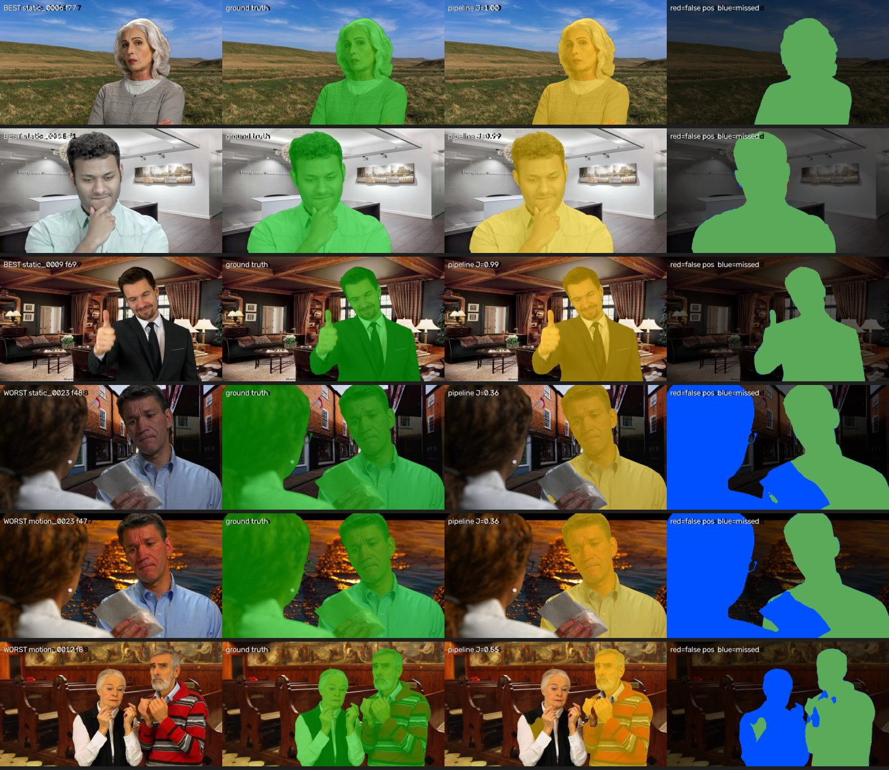
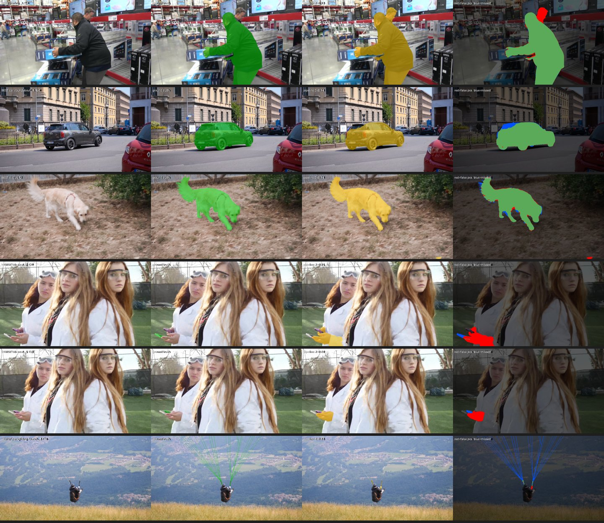
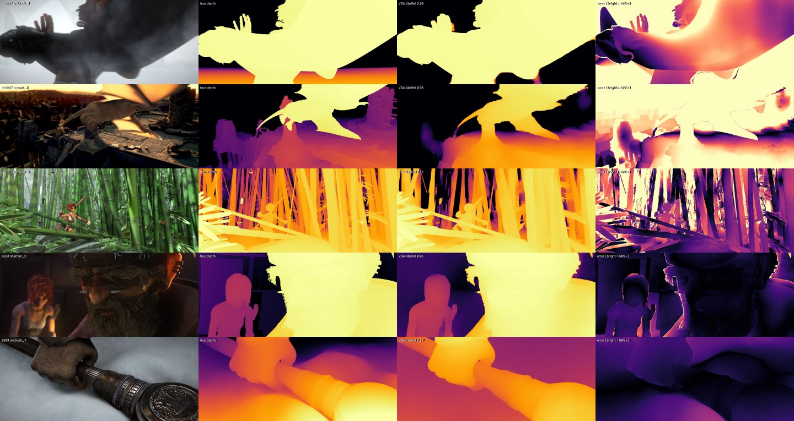

# Error analysis

## Segmentation, youtubematte (approach: pipeline = clicks → SAM 2 → MatAnyone)

| | clip | clip J | clip F | worst frame |
|---|---|---|---|---|
| best | static_0006 | 0.997 | 1.000 | frame 77: J 1.00 |
| best | static_0018 | 0.996 | 1.000 | frame 1: J 0.99 |
| best | static_0009 | 0.995 | 1.000 | frame 69: J 0.99 |
| worst | static_0023 | 0.383 | 0.635 | frame 48: J 0.36 |
| worst | motion_0023 | 0.390 | 0.657 | frame 47: J 0.36 |
| worst | motion_0012 | 0.578 | 0.584 | frame 8: J 0.55 |

## Segmentation, davis (approach: pipeline = clicks → SAM 2 → MatAnyone)

| | clip | clip J | clip F | worst frame |
|---|---|---|---|---|
| best | loading_1 | 0.978 | 0.989 | frame 44: J 0.93 |
| best | car-roundabout_1 | 0.971 | 0.931 | frame 64: J 0.94 |
| best | dog_1 | 0.959 | 0.981 | frame 2: J 0.94 |
| worst | lab-coat_2 | 0.061 | 0.446 | frame 39: J 0.01 |
| worst | lab-coat_1 | 0.077 | 0.572 | frame 33: J 0.00 |
| worst | paragliding-launch_3 | 0.138 | 0.424 | frame 76: J 0.03 |

## Depth, Sintel (Video Depth Anything)

| | sequence | AbsRel | δ1 |
|---|---|---|---|
| worst | ambush_2 | 2.105 | 0.177 |
| worst | temple_2 | 0.983 | 0.183 |
| worst | bamboo_2 | 0.522 | 0.515 |
| best | shaman_2 | 0.063 | 0.969 |
| best | ambush_7 | 0.072 | 0.993 |

VDA beats per-frame DA V2 on AbsRel in 12 of 23 Sintel sequences and flickers less in 23 of 23.
Sequences where VDA is less accurate: ambush_2 (-0.730), temple_2 (-0.273), bamboo_2 (-0.137), market_6 (-0.037), alley_2 (-0.030), market_2 (-0.028), bamboo_1 (-0.012), ambush_6 (-0.011), ambush_5 (-0.010), ambush_7 (-0.009), mountain_1 (-0.004).

## What the failures show (written from the figures above)

| Failure | Where | Cause | Fix / mitigation |
|---|---|---|---|
| object made of separate parts | YouTubeMatte 0023, 0012 (two people = one object) | the 3 automatic clicks all landed on one person, so SAM 2 tracked only that one; with the full first mask the same clips score J 0.99 | click on every separate part (`common/pick_points.py`), or start from a mask |
| object tiny in the first frame | DAVIS lab-coat objects 1–2 (14–18 px in frame 1, ~400–500 px later) | the given first mask is a speck, so the model learns almost nothing about the object's look | prompt again on a later frame where the object is bigger |
| thin structures | DAVIS paragliding-launch (lines) | 1–2 px wide, below the models' patch size | out of scope for this pipeline; manual roto |
| smoke / fog | Sintel ambush_2 | no clear surface to measure depth on | flag low-confidence frames |
| fast motion, bright sky | Sintel temple_2 | depth of the sky and the motion blur are ambiguous | temporal model helps flicker, not this error |
| many thin overlapping stems | Sintel bamboo_2 | depth edges everywhere at 518 px input | edge refinement only near the matte, so not here |
| non-human objects | DAVIS (animals, bikes) | MatAnyone is trained to matte people | use SAM 2's mask for objects, MatAnyone for people |
